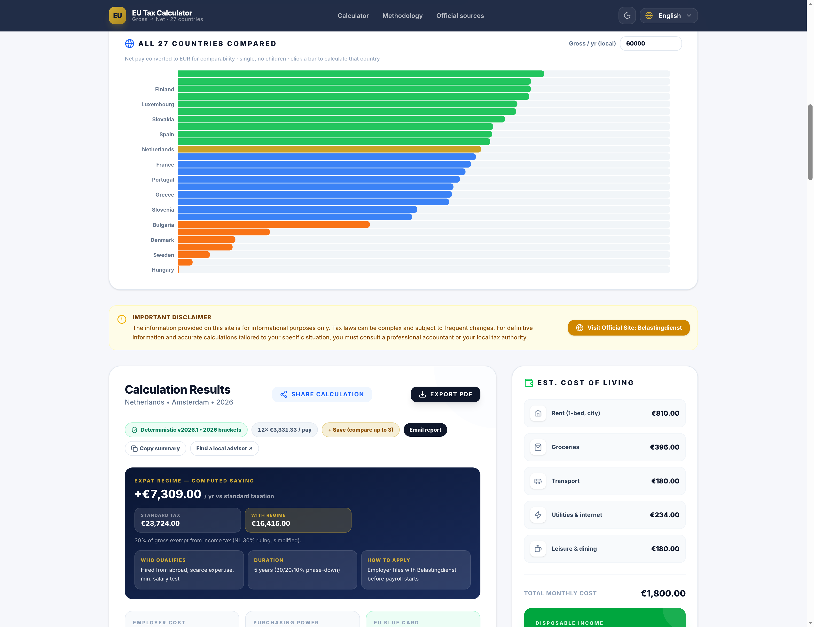
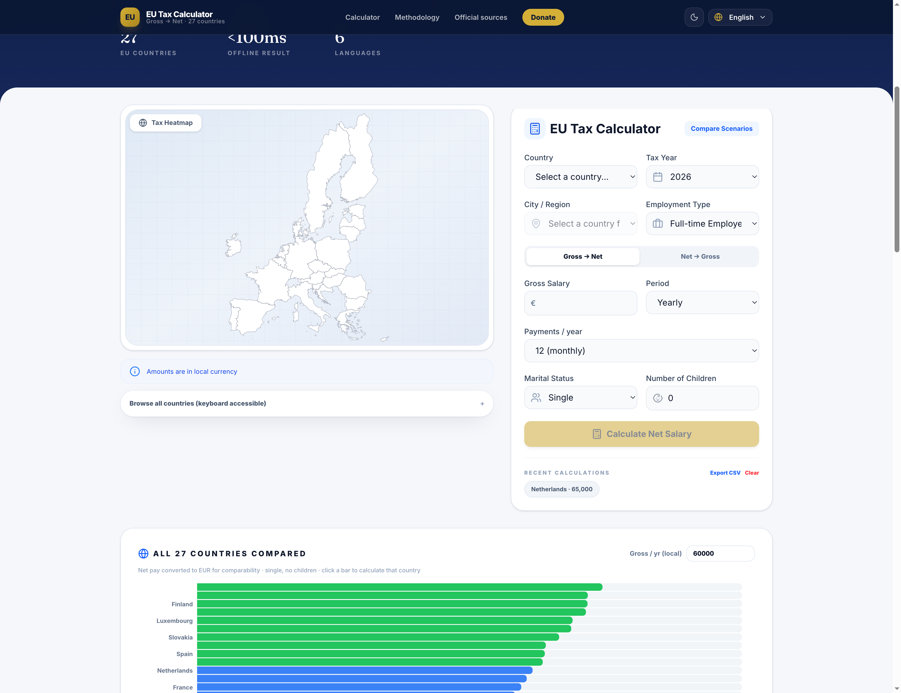

# EU Tax Calculator — Know Your True Net Salary Anywhere in Europe

Gross-to-net salary calculator across all 27 EU countries. Official 2025/2026 tax brackets, social security contributions, expat tax regimes, cost of living and visa guidance — **fully offline**, no sign-up, no API keys.

**Live demo:** https://erdalbirinci.github.io/EU-Tax-Calculator/


## Features

### Calculator
- **27 EU countries** with official 2025/2026 income tax brackets + employee social security rates
- **Gross → Net and Net → Gross** (a solver that finds the gross needed for a target net)
- Marital status, number of children, city, 12/13/14 salary payments
- **Country-specific tax logic:** France quotient familial (€1,807 cap), Germany spouse splitting (Ehegattensplitting), Austria flat 6% bonus tax
- **Expat regimes:** Dutch 30% ruling, Spain Beckham Law, Italy impatriati, France inbound regime, Portugal IFIC, Ireland SARP, Swedish expert relief, Danish researcher scheme, Finnish key personnel, Malta HQP, Cyprus/Greece exemptions — standard vs. regime tax side by side
- Employer cost, purchasing power parity (PPP), EU Blue Card eligibility check, pension projection


### Comparison and map
- **27-country comparison chart:** net pay ranking across the EU for a single gross (EUR-normalized); click a bar to calculate that country
- **Tax heatmap:** offline SVG map of Europe (d3-geo, embedded boundary data) colored by effective top-bracket rates
- Mini info card on country select: top rate, social rate, €60,000 example




### Result enrichment (all local)
After each calculation: cost-of-living breakdown, disposable income, tax optimization tips, lifestyle score, nomad index, visa guidance, social rights summary, pension outlook, country comparison table, tax flow (Sankey) chart, B2B alternative estimate.

### Sharing and export
- Shareable link with the result baked in, email report, copyable summary
- **PDF report** (one-click A4 output), print-friendly CSS
- Saved scenarios (compare up to 3 side by side), history (last 10) + **CSV export**
- Per-country tax guide pages (`#/guide/country-name`), links to all 27 official tax authorities
- 6 languages (EN/DE/FR/IT/ES/TR), dark mode, keyboard accessibility

## How it works

```
User input
  → Deterministic engine (src/data/taxRules.ts + src/services/taxEngine.ts)
  → Local enrichment (same module, from embedded datasets)
  → Result screen (<100ms, offline)
```

- **Numbers** are computed step by step from the bracket tables; the same input always yields the same result.
- **Commentary** (cost of living, tips, visas) is generated from built-in datasets and never changes the numbers.
- No requests to external services. The previously used cloud-AI integration has been removed entirely; files that once referenced `GEMINI_API_KEY` were cleaned up (`.env.example`, `vite.config.ts`, `package.json`).

## Tax tables and sources

Tables live in `src/data/taxRules.ts`; thresholds/rates verified against official sources (2025/2026):

| Country | Source | Note |
|---|---|---|
| Germany | BMF §32a EStG | Piecewise-linear fit to the 2026 formula tariff (±7%) |
| Austria | BMF Tarifstufen 2025 | 40% (since 2024), indexed thresholds |
| France | service-public.gouv.fr / BOFiP | 2026 barème + quotient familial (€1,807 cap) |
| Italy | Agenzia delle Entrate | IRPEF 23/25/43 |
| Belgium | PwC Tax Summaries (2025) | 16,320 / 28,800 / 49,840 |
| Netherlands | Belastingdienst | Box 1: 35.82% / 37.48% / 49.5% |
| Portugal | State Budget 2025 | Thresholds +4.62%, rates start at 13% |
| Spain | Agencia Tributaria | Combined state + regional approach |
| Ireland | Revenue | Blended PAYE 20%/40% + USC/PRSI |
| Sweden | Skatteverket | Skiktgräns 625,800 kr (2025) |
| Denmark | skat.dk | AM 8% + bottom/state 37.02% + topskat 15% (above 611,800 kr), ceiling 52.07% |
| Lithuania | VMI | 20% up to €126,533, 32% above (2025) |
| Latvia | Ministry of Finance | 2025 reform: 25.5% / 33% (+3 pp above €200,000) |
| Czechia | KPMG Tax Card 2025 | 23% above 1,676,052 CZK |
| Slovakia | PwC | 19% up to ~€48,441, 25% above (2025) |
| Others | EC Taxation Trends + national administrations | Verifiable via the 27 official links in the footer |

Automated verification: `npm run verify-taxes` — accounting identity (`net + tax + social = gross`), monotonicity, net→gross solver round-trips and 30+ official tariff spot checks across 27 countries × 12 income levels × marital status × children. Details: `scripts/verify-taxes.ts`.

## Development

**Requirements:** Node.js 18+

```bash
npm install     # dependencies
npm run dev     # dev server (http://localhost:3000)
npm run build   # production build (dist/)
npm run lint    # tsc type check
npm run verify-taxes  # tax engine verification tests
```

**Preview hostname:** `npm run dev` allows the hosts given in the `PREVIEW_HOSTS` env var:

```bash
PREVIEW_HOSTS="example.style.dev" npm run dev
```

**Publishing:** pushing to `main` auto-deploys to GitHub Pages via `.github/workflows/deploy.yml` (uses relative `base: './'`).

## Project structure

```
src/
  data/
    taxRules.ts        # 27-country bracket tables (official 2025/2026)
    marketExtras.ts    # guide blurbs, employer rates, PPP, Blue Card, regime effects
    socialExtras.ts    # family relief, bonus tax, city COL, visa/pension data
    cities.ts, cityCoordinates.ts, currencies.ts, expatRegimes.ts,
    qualityOfLife.ts, taxAuthorities.ts, europe.json  # embedded map
  services/
    taxEngine.ts       # deterministic engine + local enrichment (offline)
  components/
    TaxCalculator.tsx  # form + results screen
    CountryCompare.tsx # 27-country comparison chart
    EuropeMap.tsx      # offline SVG map (d3-geo)
    CountryGuide.tsx   # country guide pages
    TaxSankey.tsx, CountUp.tsx
  i18n/                # 6-language translations
scripts/
  verify-taxes.ts      # tax verification harness
docs/screenshots/      # README images
```

## Limitations

An estimation tool, not tax advice. Regional surcharges (Spanish autonomous regions, Italian regional/municipal add-ons, Belgian municipal tax), church tax and some personal deductions are not modelled. Estonia's basic exemption and Slovakia's 2026 top brackets are approximate. Confirm with your local tax authority before signing a contract.
