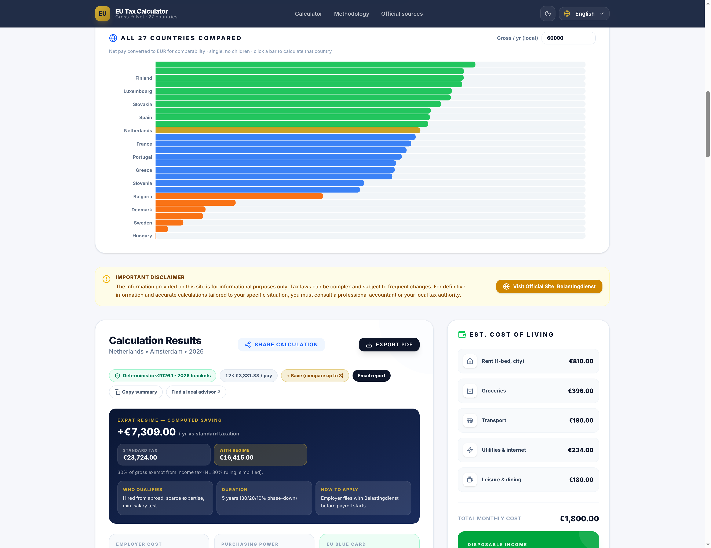
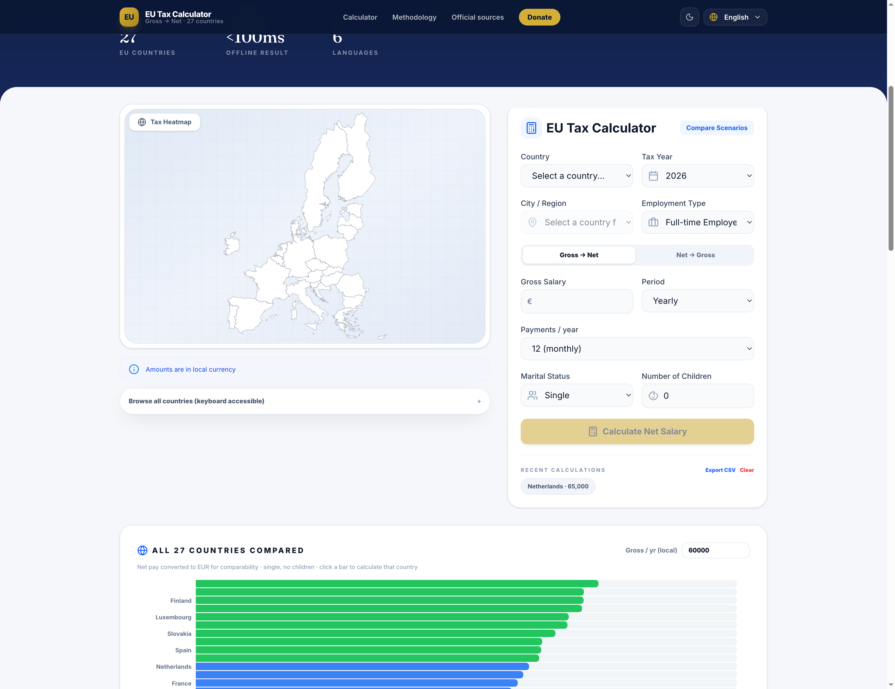

# EU Tax Calculator — Know Your True Net Salary Anywhere in Europe

Gross-to-net salary calculator across all 27 EU countries. Official 2025/2026 tax brackets, social security contributions, expat tax regimes, cost of living and visa guidance — **fully offline**, no sign-up, no API keys.

**Live demo:** https://erdalbirinci.github.io/EU-Tax-Calculator/


## Features

### Calculator
- **27 EU countries × 2 tax years (2025 and 2026)**, each with its own verified bracket table and employee contribution rates — the year selector only offers years that are actually modelled
- **Gross → Net and Net → Gross** (a solver that finds the gross needed for a target net)
- Marital status, number of children, city, 12/13/14 salary payments
- **Country-specific tax logic:** France quotient familial (€1,807 cap), Germany spouse splitting (Ehegattensplitting), Austria flat 6% bonus tax
- **Expat regimes:** Dutch 30% ruling, Spain Beckham Law, Italy impatriati, France inbound regime, Portugal IFIC, Ireland SARP, Swedish expert relief, Danish researcher scheme, Finnish key personnel, Malta HQP, Cyprus/Greece exemptions — standard vs. regime tax side by side
- Employer cost, purchasing power parity (PPP), EU Blue Card eligibility check, pension projection


### Comparison and map
- **27-country comparison chart:** net pay ranking across the EU for a single gross (EUR-normalized); click a bar to calculate that country
- **Tax heatmap:** offline SVG map of Europe (d3-geo, embedded boundary data) colored by effective top-bracket rates
- Mini info card on country select: top rate, social rate, €60,000 example




### Result enrichment (all local)
After each calculation: cost-of-living breakdown, disposable income, tax optimization tips, lifestyle score, nomad index, visa guidance, social rights summary, pension outlook, country comparison table, tax flow (Sankey) chart, B2B alternative estimate.

### Sharing and export
- Shareable link with the result baked in, email report, copyable summary
- **PDF report** (one-click A4 output), print-friendly CSS
- Saved scenarios (compare up to 3 side by side), history (last 10) + **CSV export**
- Per-country tax guide pages (`#/guide/country-name`), links to all 27 official tax authorities
- 6 languages (EN/DE/FR/IT/ES/TR), dark mode, keyboard accessibility

## How it works

```
User input
  → Deterministic engine (src/data/taxRules.ts + src/services/taxEngine.ts)
  → Local enrichment (same module, from embedded datasets)
  → Result screen (<100ms, offline)
```

- **Numbers** are computed step by step from the bracket tables; the same input always yields the same result.
- **Commentary** (cost of living, tips, visas) is generated from built-in datasets and never changes the numbers.
- No requests to external services. The previously used cloud-AI integration has been removed entirely; files that once referenced `GEMINI_API_KEY` were cleaned up (`.env.example`, `vite.config.ts`, `package.json`).

## Tax tables and sources

Tables live in `src/data/taxRules.ts`, one block per tax year, each re-checked against primary national sources (Nov 2026):

| Country | 2026 changes worth knowing | Source |
|---|---|---|
| Germany | §32a formula fitted with six linear slices (±0.5%); health/care ceiling €69,750, pension €101,400 | BMF Datensammlung 2026 |
| Austria | Indexed Tarifstufen (13,539 / 21,992 / 36,458 / 70,365 / 104,859), social ceiling €97,020 | BMF Steuertarif |
| France | 2026 barème 11,600 / 29,579 / 84,577 / 181,917 + 10% abattement (cap €14,555) + quotient familial | service-public F1419, BOFiP |
| Italy | **Middle rate cut 35% → 33%** for 2026 (Legge 199/2025) | Agenzia delle Entrate |
| Netherlands | Box 1 8.10 / 37.56 / 49.5, national insurance 27.65% (cap €38,883), credit €3,115 | Belastingdienst |
| Belgium | Brackets 16,720 / 29,510 / 51,070 and tax-free sum €11,550 | FOD Financiën |
| Greece | **New six-bracket scale** 9/20/26/34/39/44 (Law 5246/2025) | minfin.gr, AADE |
| Cyprus | **2026 reform**: tax-free amount €22,000, bands 32/42/72k | Tax Department CY |
| Denmark | **Middle-bracket tax added**: 37.06% to 641,200, +7.5% to 777,900, +7.5% to 2,592,700, +5% above | skat.dk |
| Finland | New state scale (top steps removed) + municipal 7.60%; contributions 10.17% | Vero |
| Sweden | Skiktgräns 643,000; municipal 32.38%; 7% pension contribution fully credited | Skatteverket |
| Slovakia | **Four brackets** 19/25/30/35, health contribution 5% | Finančná správa |
| Lithuania | **New 25% band** 83,237–138,729 (20/25/32) | VMI, Sodra |
| Portugal | 2026 rates 12.2 → 48% (DL 212/2026) | Autoridade Tributária |
| Bulgaria | **Euro area since 1 Jan 2026** — table switches BGN → EUR | NRA, SSIB 2026 |
| Czechia | Threshold 1,762,812 CZK; social ceiling 2,350,416; credit 30,840 | Finanční správa |
| Slovenia | Indexed brackets, allowance €5,551.93, contributions 23.10% | FURS |
| Poland | ZUS ceiling 282,600 PLN; health contribution not deductible | ZUS, podatki.gov.pl |
| Others | Values unchanged or indexed only | National administrations (27 links in the footer) |

Automated verification: `npm run verify-taxes` — for **both** tax years it checks the accounting identity (`net + tax + social = gross`), monotonicity, contribution-ceiling saturation, net→gross solver round-trips, and ~40 official tariff anchors computed by hand from the statute (e.g. German §32a, Dutch Box 1 + credit, French barème + abattement). It also asserts that the countries whose law changed between 2025 and 2026 actually differ. Details: `scripts/verify-taxes.ts`.

### What the engine models

| Mechanism | Where it applies |
|---|---|
| Progressive brackets on a country-specific base | all 27 |
| Contribution ceilings (health / pension split) | DE, AT, NL, CY, EE, LV, LT, PL, RO, SE, BG, HR, SI, IE, DK… |
| Base = gross − employee contributions | BE, DK, FR, IT, LT, LU, SI, SK, BG, HR |
| Base = gross − deducted contributions only | PL (ZUS deductible, 9 % health contribution not), FR (10 % abattement) |
| Personal allowance in the base | DE, ES, EE, LV, LT, SE, DK, SI, HR, RO, SK, PT |
| Allowance that tapers with income | SK, LT (NPD), RO (income cap) |
| Tax credit at the lowest rate (not a base deduction) | BE (25 % of the tax-free sum), CZ, EE, IE |
| Credit that phases out with income | GR (€777, −2 %) |
| Credit that rises then phases out | NL (algemene heffingskorting + arbeidskorting, piecewise schedule) |
| Progressive social charge | IE (USC) |
| Marriage splitting | DE (Ehegattensplitting) |
| Dated Blue Card lines | Year-split thresholds; unpublished years hold the last published figure and the UI labels its reference year — never projected |
| Family parts | FR (quotient familial, €1,807 cap per half part) |
| Flat bonus-payment tax | AT (6 % on 13th/14th salary) |

## Development

**Requirements:** Node.js 18+

```bash
npm install     # dependencies
npm run dev     # dev server (http://localhost:3000)
npm run build   # production build (dist/)
npm run lint    # tsc type check
npm run verify-taxes  # tax engine verification tests
```

**Preview hostname:** `npm run dev` allows the hosts given in the `PREVIEW_HOSTS` env var:

```bash
PREVIEW_HOSTS="example.style.dev" npm run dev
```

**Publishing:** pushing to `main` auto-deploys to GitHub Pages via `.github/workflows/deploy.yml` (uses relative `base: './'`).

## Project structure

```
src/
  data/
    taxRules.ts        # 27-country bracket tables (official 2025/2026)
    marketExtras.ts    # guide blurbs, employer rates, PPP, Blue Card, regime effects
    socialExtras.ts    # family relief, bonus tax, city COL, visa/pension data
    cities.ts, cityCoordinates.ts, currencies.ts, expatRegimes.ts,
    qualityOfLife.ts, taxAuthorities.ts, europe.json  # embedded map
  services/
    taxEngine.ts       # deterministic engine + local enrichment (offline)
  components/
    TaxCalculator.tsx  # form + results screen
    CountryCompare.tsx # 27-country comparison chart
    EuropeMap.tsx      # offline SVG map (d3-geo)
    CountryGuide.tsx   # country guide pages
    TaxSankey.tsx, CountUp.tsx
  i18n/                # 6-language translations
scripts/
  verify-taxes.ts      # tax verification harness
docs/screenshots/      # README images
```

## Regulatory compliance (EU)

- **GDPR / ePrivacy:** no backend, no cookies, no analytics, no ads, no external requests (fonts are self-hosted). Browser storage (theme, saved scenarios, history, result cache) is written only after consent via the on-site banner; “Essential only” keeps everything session-only in memory. Details and a one-click “delete all my data” button: in-app Privacy Policy (`#/privacy`).
- **Consumer transparency:** every result page carries an estimate-only disclaimer; the footer states the project is independent and not affiliated with EU institutions or tax authorities (`#/legal`).
- **Accessibility (EAA/WCAG 2.1 AA):** skip link, landmarks, visible focus, keyboard-operable country selection (chart bars are decorative — the same countries are reachable as real buttons), 6-language UI.
- **AI Act:** no AI system is used — figures are computed deterministically from fixed tables.

## Limitations

An estimation tool, not tax advice. Deliberately **not** modelled: the employee tax detrazione of Italy, the Spanish *reducción por rendimientos del trabajo*, the Dutch pension-premium split, regional and municipal surcharges that vary by locality (Spanish autonomous regions, Italian regional/municipal add-ons, Belgian municipal tax, Croatian local rates use the 20/30 default), church tax, property and wealth taxes, employer-side details, and individual deductions such as commuting, home office, church, union dues or private pension top-ups.

Every other simplification is listed in `notesEn` on the country record — for example Germany's health/care ceiling vs pension ceiling, France's CSG split, or the Irish PRSI step from 4.2% to 4.35% in October 2026. Only 2025 and 2026 are modelled; earlier years are deliberately not offered rather than shown with the wrong tables. Confirm with your local tax authority before signing a contract.
